<div align="center">

# ⚡ AOS — Agent Operating System
### The Deterministic System-1 / System-2 Cognitive Kernel for AI Coding Agents

[-success?style=for-the-badge&logo=pytest)](https://github.com/GamalxX/aos)
[](https://github.com/GamalxX/aos)
[](https://github.com/GamalxX/aos#-3-arm-controlled-benchmark-results)
[-orange?style=for-the-badge)](https://github.com/GamalxX/aos#-dual-mind-architecture-system-1--system-2)
[](https://github.com/GamalxX/aos#-quick-start--mcp-integration)

**Stop paying LLMs to read entire files, dump raw terminal logs, and hallucinate "passing" tests.**  
AOS sits between your IDE (**Antigravity, Cursor, Claude Code, Windsurf**) and your LLMs—slicing ASTs surgically, training a **65KB project LoRA on your CPU in <60s**, blocking agent sycophancy with **Ed25519 cryptographic receipts**, and cutting token bills by **over 90%**.

[Quick Start](#-quick-start--mcp-integration) · [3-Arm Benchmark](#-3-arm-controlled-benchmark-results) · [System 1 & 2 Architecture](#-dual-mind-architecture-system-1--system-2) · [6 Domain Workflows](#-the-6-specialized-domain-workflows--enhance) · [Control Center UI](#-aos-control-center-localhost4141)

</div>

---

## 🚨 The Problem with Today's Coding Agents

Modern AI coding assistants suffer from three structural flaws:
1. **Context Bloat & N+1 Tool Chattering:** Agents read 8 full files sequentially and ingest thousands of lines of raw terminal logs just to fix a 10-line function.
2. **Sycophantic Self-Certification:** Models claim *"All tests passed 100%!"* without executing a single test, or invent fake edits on clean codebases.
3. **Ambient Secret Leakage:** API keys (`stripe_live_*`, `.env` credentials) are silently ingested into cloud prompt contexts.

**AOS fixes all three at the OS kernel level—before a single token leaves your machine.**

---

## 📊 3-Arm Controlled Benchmark Results

Tested across a production-grade **1,600+ line financial codebase** comparing a standalone frontier LLM (**Arm A**) against the exact same LLM powered by **AOS Kernel (Arm B)**:

| Metric Measured | Arm A: Standard Agent (No AOS) | Arm B: Agent + **AOS Runtime** | Verified Improvement |
| :--- | :---: | :---: | :--- |
| **Prompt Input Tokens** | 14,764 tokens | **952 tokens** | **🔥 93.55% Token Reduction** |
| **Generated Output Tokens** | 5,461 tokens | **1,287 tokens** | **🔥 76.43% Output Reduction** |
| **Config & Invariant Queries** | Full file ingestion (2.2 KB) | **3.33 ms (System-1 Fast-Path)** | **⚡ 0 LLM Tokens (100% Free)** |
| **Cloud API Cost per Task** | $0.04576 / task | **$0.00762 / task** | **💰 83.3% Cost Savings** |
| **End-to-End Task Latency** | ~28.0 seconds (8 MCP calls) | **~17.5 seconds (`prepare_batch`)** | **⏱️ 37.5% Faster Execution** |
| **Live Secret Protection** | Raw key exposed in prompt | **Hardware Wire `[REDACTED]`** | **🔒 100% Zero-Leak Guarantee** |
| **First-Pass Test Verification** | 6 / 6 | **6 / 6 (Ed25519 Signed)** | **✅ Zero Functional Regressions** |

---

## 🧠 Dual-Mind Architecture: System 1 & System 2

Inspired by Daniel Kahneman's cognitive science, AOS splits agent execution into two tightly coupled engines across **38 subsystems (130,344 SLOC)**:

```mermaid
flowchart LR
    TaskInput["Developer Prompt / Task"] --> Triage{"Deterministic or Known Instinct?"}

    subgraph S1 ["⚡ System 1: Reflexive Fast-Path (0.8ms - 5.5ms)"]
        direction TB
        F1["Zero-Model Engine (0 Tokens)"]
        F2["Failure Negative Cache (0ms Block)"]
        F3["Crystallized Python Instincts"]
        F4["Hardware Wire Secret Redactor"]
    end

    subgraph S2 ["🧠 System 2: Analytical Orchestration"]
        direction TB
        P1["Batch MCP Prepare (Single Round-Trip DAG)"]
        P2["Precision AST Slicer + Pinpoint Flow Map"]
        P3["6 Selective Domain Workflows"]
        P4["Anti-Sycophancy Gate & Ed25519 Audit"]
    end

    Triage -- "Yes (93% of Config/State Queries)" --> S1
    Triage -- "No (Code Mutation & Architecture)" --> S2

    S1 --> FastOut["Instant Verified Response (0 Tokens)"]
    S2 -- "Workflow Succeeds >= 3x" --> Crystallize["Crystallize into System-1 Instinct"]
    Crystallize -.-> S1
    S2 --> VerifiedOut["Cryptographically Verified Code + ACTIVE_MISSION.md"]
```



### 1. Native CPU Cognition (3.14M Mother Model + 65KB Project Child LoRA)

AOS embeds its own ultra-lightweight neural cognition stack that runs 100% on standard CPUs with zero GPU requirement:
- **The Mother Model (`mother-v1-seed-0001`):** A 3.14M-parameter Causal Transformer (~12 MB) with SwiGLU and RoPE that acts as the kernel's conscience—guarding sandbox invariants, scoring risk, and preventing infinite repair loops in milliseconds.
- **Pre-First-Prompt Child Acclimation (65 KB Multi-LoRA):** The moment you open a project, `ProjectChildModelFactory` scans your repository's `ProjectGenome` and trains a 65 KB project-specific LoRA adapter on your CPU in under 60 seconds—before you even type your first prompt:

$$\mathbf{y} = \mathbf{x} \mathbf{W}_{\text{base}} + \left(\mathbf{x} \mathbf{A}_{\text{prod}}^T\right) \mathbf{B}_{\text{prod}}^T \cdot \frac{\alpha_{\text{prod}}}{r_{\text{prod}}} + \left(\mathbf{x} \mathbf{A}_{\text{child}}^T\right) \mathbf{B}_{\text{child}}^T \cdot \frac{\alpha_{\text{child}}}{r_{\text{child}}}$$

### 2. Batch MCP Prepare & Precision AST Slicing

- **`prepare_batch` Single Round-Trip:** Decomposes complex prompts into a linked Task DAG and fetches all required AST slices, call-graph coordinates, and project invariants in one MCP call—eliminating the 8-call MCP tax.
- **Pinpoint Code Flowchart & Architecture Delta:** Injects an ultra-compact topological call map (`file.py::symbol(L10-L45) -> ...`) alongside AST slices, and computes verified post-edit diffs (`ADDED`, `MODIFIED`, `REMOVED`, `MOVED`, `REWIRED`).

### 3. Workflow Crystallization & Failure Negative Cache

- **Never Repeat a Failed Fix:** Every failed patch is hashed against the exact AST state in `FailureNegativeCache`. If an agent proposes the same broken strategy again, AOS blocks it deterministically in 0ms.
- **Self-Evolving Instincts:** When a System-2 workflow succeeds $\ge 3$ times, `CrystallizationExecutor` compiles the pattern into a deterministic System-1 Python instinct—executing future occurrences at 0 token cost.

---

## 🛡️ The 6 Specialized Domain Workflows & /enhance

Unlike heavy multi-agent frameworks that spawn 5 separate LLMs that burn tokens chatting with each other, AOS implements **Specialized Operational Workflows** dispatched selectively on-demand (Selective Dispatch) using your active model:

- 🎨 **Front-End Workflow:** Enforces AST-level surgical diffs and extracts project design tokens (`--color-*`, Tailwind scales) so agents never invent random hex colors.
- ⚙️ **Back-End Workflow:** Enforces strict `DataContracts`, schema integrity, and decimal precision for financial/data pipelines.
- ✨ **UI/UX Design Intelligence:** Separates Product Truth, Design System Tokens, and Surface Modes (`OPERATE`, `PERSUADE`, `READ`, `EXPERIENCE`) with a 0-token Static UI Detector that catches duplicate DOM IDs, missing `aria-label`/`alt`, and `100vw` horizontal overflow in <2ms.
- 🔒 **Security Workflow:** Features a `DeterministicTerminalParser` that compresses raw test/scanner terminal output by 80%–95%, auto-detects polyglot test frameworks (`pytest`, `jest`, `vitest`, `cargo test`, `go test`, `JUnit`), and hunts OWASP Top 10 & Auth/ACL bypasses.
- 🚀 **Performance Workflow:** Scans ASTs for nested $O(N^2)$ loops, enforces $O(1)$ Hash Set/Map lookups, and runs an AST Complexity Sentinel that rejects patches that degrade cognitive complexity.
- 💎 **/enhance (`AosProjectEnhancer` — On-Demand 360° Audit):**
  - Invoked explicitly by the developer (`action="enhance"`).
  - Orchestrates all 5 domain auditors, applies surgical auto-remediation, and validates through the `AntiSycophancyGate`.
  - **Strictly Idempotent:** Run `/enhance` once to fix real defects; run it a second time and it returns a 100% Health Scorecard with 0 fake edits.

---

## 💰 Dual-Format Economics & Inter-Model JSON Relay

AOS maximizes human clarity while starving LLM token billing:

### Dual-Format Output ($\le 62$ Tokens for AI vs. 0-Token File for Humans)
- **AI Wire Format (`human_view=False`):** Sends ultra-compact micro-notation (~20–62 tokens) inside MCP responses.
- **Zero-Token Live Developer File:** Python automatically writes `.aos/continuity/ACTIVE_MISSION.md` directly to disk (0 LLM tokens) with your live `[x]` / `[~]` / `[ ]` checklist, exact resume line cursor (`file::symbol(Lstart-Lend)`), and a sanitized Mermaid flowchart.

### Inter-Model Compact JSON Relay & Smart Language Bridge
- **Write prompts in any language** (Arabic, Chinese, Spanish, German, English) with an optional Prompt Optimizer.
- **Instructs your expensive Primary LLM to reply strictly in Ultra-Compact JSON** (slashing expensive output tokens by 76%+), while a free/cheap Assistant LLM unpacks and explains the result in your native language.
- **3-Mode Comment Verbosity Engine:** Choose between Verbose, Professional Minimal (1–3 header lines + 1-line docstrings), or Zero Comments (pure code, maximum speed and token savings).

---

## 🖥️ AOS Control Center (localhost:4141)

AOS includes an on-demand, zero-zombie web Control Center that shuts down automatically when you close the tab or IDE:

- **10+ Pluggable Delegate Engines:** Seamlessly connect Ollama (Local & Cloud), LM Studio (`:1234`), vLLM (`:8000`), Groq, DeepSeek, Google Gemini, OpenRouter, Custom OpenAI/Anthropic, or Active Host Sampling—protected by automatic Circuit Breakers and Exact-Match Contract Caching.
- **Live Mission HUD:** Auto-syncs `.aos/continuity/ACTIVE_MISSION.md` every 3 seconds with interactive Mermaid architecture diagrams and one-click PR summary export.
- **Hardware-Bound Credential Vault:** API keys are encrypted using machine-specific hardware entropy (Windows DPAPI / AES-256-GCM) and enforced by a fail-closed `PrivacyEgressGate` (`LOCAL_REQUIRED` / `NO_EXTERNAL_DATA`).

---

## 🚀 Quick Start & MCP Integration

### 1. Install AOS (Frictionless 1-Line Onboarding)

**Windows (PowerShell):**
```powershell
# Clone and run automated setup
git clone https://github.com/GamalxX/aos.git
cd aos
.\install.ps1
```

**macOS / Linux (Bash):**
```bash
# Clone and run automated setup
git clone https://github.com/GamalxX/aos.git
cd aos
chmod +x ./install.sh && ./install.sh
```

**Or Install from Release Package / Wheel:**
```bash
pip install dist/aos-1.0.0-py3-none-any.whl
aos setup
```

### 2. Connect to Your IDE (Antigravity / Cursor / Claude Code / Windsurf)

Add the following standardized block to your IDE's `mcp_config.json` (or `.cursor/mcp.json` / `antigravity_mcp.json`):

```json
{
  "mcpServers": {
    "aos": {
      "command": "aos-mcp",
      "env": {
        "AOS_ENV": "production",
        "PYTHONIOENCODING": "utf-8"
      }
    }
  }
}
```
*(Tip: `aos setup` automatically detects your installed IDEs and injects this configuration with zero manual editing).*

### 3. Launch the Control Center & CLI Diagnostics

```bash
# Verify system health and local engines
aos doctor

# Launch the interactive Web Control Center on http://127.0.0.1:4141
aos-settings
```

---

## 💎 Editions: AOS Community vs. AOS Pro & Team

| Capability | AOS Community (Free) | AOS Pro & Team |
| :--- | :---: | :---: |
| **Precision AST Slicer & `prepare_batch` (93.5% Token Savings)** | ✅ Included | ✅ Included |
| **System-1 Fast-Path & Native CPU Mother/Child LoRA** | ✅ Included | ✅ Included |
| **Hardware Secret Redactor & Local Control Center (:4141)** | ✅ Included | ✅ Included |
| **All 6 Domain Workflows & Idempotent `/enhance` Engine** | ✅ Included | ✅ Included |
| **Inter-Model Compact JSON Relay & Smart Language Bridge** | Community Quota | Unlimited High-Speed Relay |
| **Team Knowledge Mesh (Encrypted Cross-Dev Instinct Sync)** | — | ✅ Included |
| **Zero-Day Domain Invariant Packs (Fintech, SecOps, Gaming)** | — | ✅ Included |
| **Headless CI/CD Reality Gate (GitHub Actions Ed25519 Blocker)** | — | ✅ Included |
| **Executive ROI & Cryptographic Audit Dashboard** | — | ✅ Included |

---

<div align="center">

**Engineered for zero waste, mathematical verification, and absolute code privacy.**  
`130,344 SLOC` · `38 Subsystems` · `1,885 Automated Tests Passing`

</div>
